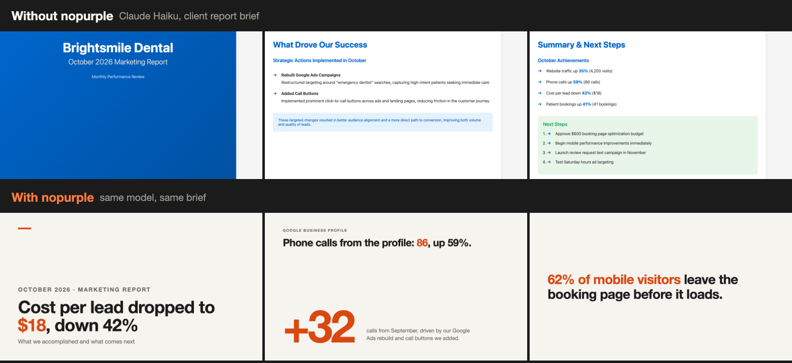
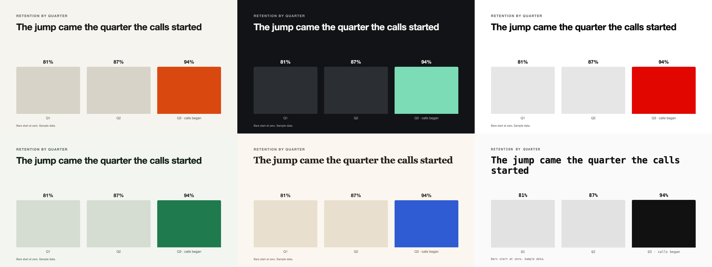
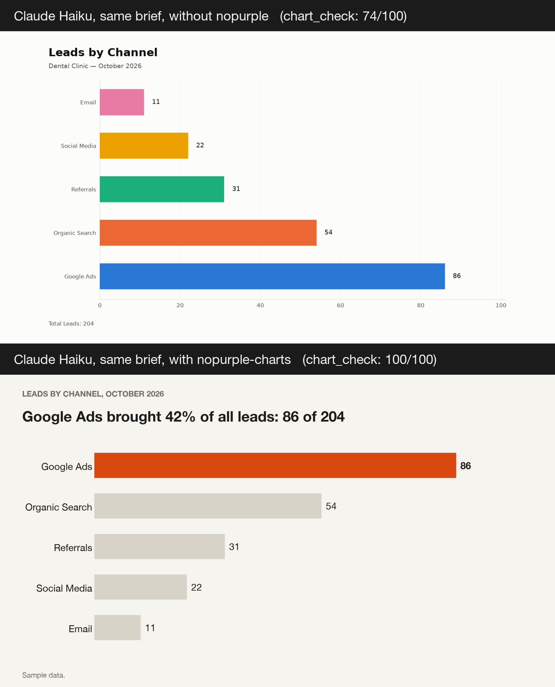

<div align="center">

# nopurple

**Slides and charts that look designed by a person, not generated by AI.**

[](https://github.com/taufiquebuilds/nopurple/actions/workflows/ci.yml)
[](LICENSE)



</div>

You know the AI deck when you see it: a blue or purple gradient, a centred title, "What Drove Our Success", arrows in front of every line, and a "Summary & Next Steps" slide nobody reads. **nopurple** is a pack of agent skills that makes your AI write and design decks the way a good consultant would, and draw charts the way a newspaper graphics desk would: one point, the real number up front, honest scales, and a clean theme. It works in Claude Code, Codex, Cursor and any agent that supports skills.

```
/plugin marketplace add taufiquebuilds/nopurple
/plugin install nopurple@nopurple
```

Then: **"make a deck from these notes"** or **"chart this data for the client report"**.

*The image above is real output, not a mock-up: the same brief, the same model, with and without the skill. Details are under [How we tested it](#how-we-tested-it).*

## Skills

| Skill | Use it for |
| --- | --- |
| `nopurple-slides` | Decks, pitch decks, slide-based reports, PowerPoint and Google Slides |
| `nopurple-charts` | Charts and graphs in matplotlib, Plotly, Chart.js, Recharts, Vega-Lite, Excel or Sheets |

Your agent picks the right one from what you ask for.

## Slides: what changes

| AI default | With nopurple |
| --- | --- |
| Topic titles: "Phone Calls & Lead Quality Improvement" | The point as a sentence: "Phone calls from the profile: 86, up 59%" |
| Gradient backgrounds, frosted cards, emoji bullets | 6 calm themes, one accent colour used for one thing per slide |
| 60–100 words per slide | Under 40 words; detail goes in speaker notes |
| "Significant growth" | "+13 points" |
| Charts stretched to look dramatic | Bars that start at zero, values labelled |
| Made-up dates, quotes and "facts" | Only your facts. Anything missing becomes a visible `[?]` |
| "Thank you! Questions?" | The ask: what you need, from whom, and by when |

## Slides: how it works

Your agent follows a 7-step workflow:
1. Get the story and the real facts.
2. Write the headlines first.
3. Pick a layout for each slide.
4. Build from a template.
5. **Render every slide to an image and look at it.**
6. Run a slop check.
7. Hand over, listing anything you need to confirm.

You get:

- **`skills/slides/templates/deck.html`:** a single-file HTML deck with 6 themes and 11 layouts. Present it from the browser, or export it to PDF.
- **PowerPoint output** with the same design, via `python-pptx`, for decks you'll edit in PowerPoint, Keynote or Google Slides.
- **`skills/slides/scripts/render.py`:** turns the deck into PNGs and a PDF using Chrome, so the agent can see its own slides.
- **`skills/slides/scripts/slop_check.py`:** scores any `.pptx`, `.html` or Markdown deck for AI-slop patterns. It works on decks you already have, too.



## Check a deck you already have

```sh
python3 skills/slides/scripts/slop_check.py examples/before-ai-deck.html   # or any .pptx / .md deck
```

```
Slop check: 41/100 (AI slop), 6 slides, before-ai-deck.html
  deck: Purple gradient background: the most recognisable AI-deck look.
  deck: 4 font families. Use one, or two at most.
  slide 2: Topic title "📋 Agenda". Make the title the point, as a sentence.
  slide 3: 6 bullets. Keep 3 to 5, or split the slide.
  slide 3: Hype words: empowered, innovative, leveraged, robust.
  slide 6: "Thank you" ending. End on the decision or next step instead.
  …
```

Or ask your agent: **"make this deck look less AI-generated"**. It runs the check, rewrites the titles, rebuilds the slides and shows you the before and after scores.

## Charts



*Real output from one test: the same brief and the same model, with and without the skill.*

| AI default | With nopurple-charts |
| --- | --- |
| "Leads by Channel" | The finding: "Google Ads brought 42% of all leads: 86 of 204" |
| A different colour for every bar | Grey, plus one accent for the thing the title is about |
| Gridlines, axis ticks and a legend | Values labelled on the marks |
| Pies, 3D and exploded slices | Sorted bars, lines and slope charts |
| Bars that start at 50 to look dramatic | Bars that start at zero |
| Labels rotated 45 degrees | Horizontal bars, so labels read straight |

You get:

- **`skills/charts/scripts/chart_style.py`:** matplotlib functions (`hbar`, `bar`, `line`, `slope`, `finish`) with the rules built in, in the same 6 themes as the slides.
- **`skills/charts/references/libraries.md`:** the same look in Plotly, Chart.js, Recharts, Vega-Lite, Excel and Google Sheets.
- **`skills/charts/scripts/chart_check.py`:** scores chart code for slop. It works on charts you already have:

```sh
python3 skills/charts/scripts/chart_check.py report_chart.py   # also .ipynb, .js, .ts, .jsx, .tsx, .json, .html
```

```
Chart check: 74/100 (some slop), chart.py
  line 16: Rainbow colour list: make everything grey except the one thing the title is about.
  line 75: Gridlines: remove them and label the values directly.
  line 91: Topic title "Leads by Channel": write the finding as a sentence with its number, e.g. "Google Ads brought 42% of all leads".
```

## Install

**Claude Code:**

```
/plugin marketplace add taufiquebuilds/nopurple
/plugin install nopurple@nopurple
```

**Codex, Cursor, OpenCode and other agents** (via [skills](https://skills.sh)):

```sh
npx skills add taufiquebuilds/nopurple --global --agent '*'
```

**Requirements:** Python 3.9 or newer. For slides: Chrome, Chromium or Edge for rendering, and `python-pptx` only if you want `.pptx` output. For charts: `matplotlib` for `chart_style.py`. Both checkers need only Python.

## How we tested it

**Slides.** We gave one brief, a monthly marketing report for a dental clinic, to agents with and without nopurple, then rendered every slide.

- **With a smaller, faster model (Claude Haiku),** the difference is large. Without the skill, it made the deck in the top half of the image: topic titles, a gradient title slide, and text packed into coloured boxes. With the skill, it made the bottom half, and it scored 100 on the slop check.
- **With the strongest models,** the gap is smaller. They already avoid the worst slop on their own. nopurple still kept slides shorter and charts honest, and it stopped the model adding claims that weren't in the notes, which the model without the skill did.

The slides test also caught two bugs in the skill: a template date copied into the final deck, and a stylesheet that broke when curly quotes were flattened. Both are fixed, and the slop check now catches each of them.

**Charts.** We gave Claude Haiku five numbers (leads by channel, labelled as sample data) and asked for a chart for a client report, with and without nopurple-charts. Without the skill, it drew sorted bars in five colours with gridlines and a topic title, with the largest bar at the bottom. With the skill, it wrote the finding as the title, checked that 86 of 204 is 42%, and highlighted one bar. The first run with the skill copied "Source: CRM export" from the skill's example, which wasn't true for sample data. We changed the example, and the run in the image above writes "Sample data." instead.

## FAQ

**Does it work with PowerPoint and Google Slides?**
Yes. The skill builds an editable `.pptx` with the same layouts and theme. Google Slides and Keynote open `.pptx` files directly. The slop check reads `.pptx` too.

**Can I use my brand colours?**
Yes. Change `--accent` in the theme to your brand colour. Keep the background neutral: brand colours work best as the accent.

**Will it make things up to fill a slide?**
No. That's a core rule. Numbers, quotes and dates come only from what you give it. Anything missing becomes `[?]`, and the agent lists those items for you to fill in.

**Why "nopurple"?**
Because the purple gradient is the most recognisable sign of an AI-made deck, and the name is a promise.

## Roadmap

- [ ] Line and stacked-bar chart layouts for slides
- [ ] Small multiples and a stacked share bar in `chart_style.py`
- [ ] More skills in the pack: reports and one-pagers
- [ ] A `--fix` mode for the slop check that rewrites titles in a `.pptx`
- [ ] Brand kit file (logo, colours, font) applied automatically
- [ ] More themes, contributed by designers

## Contributing

The most useful contribution is a new slop pattern: something that marks a deck or chart as AI-made, plus what a designer would do instead. Open a [slop pattern issue](https://github.com/taufiquebuilds/nopurple/issues/new?template=slop_pattern.yml). For code, see [CONTRIBUTING.md](CONTRIBUTING.md).

## License

[MIT](LICENSE)
